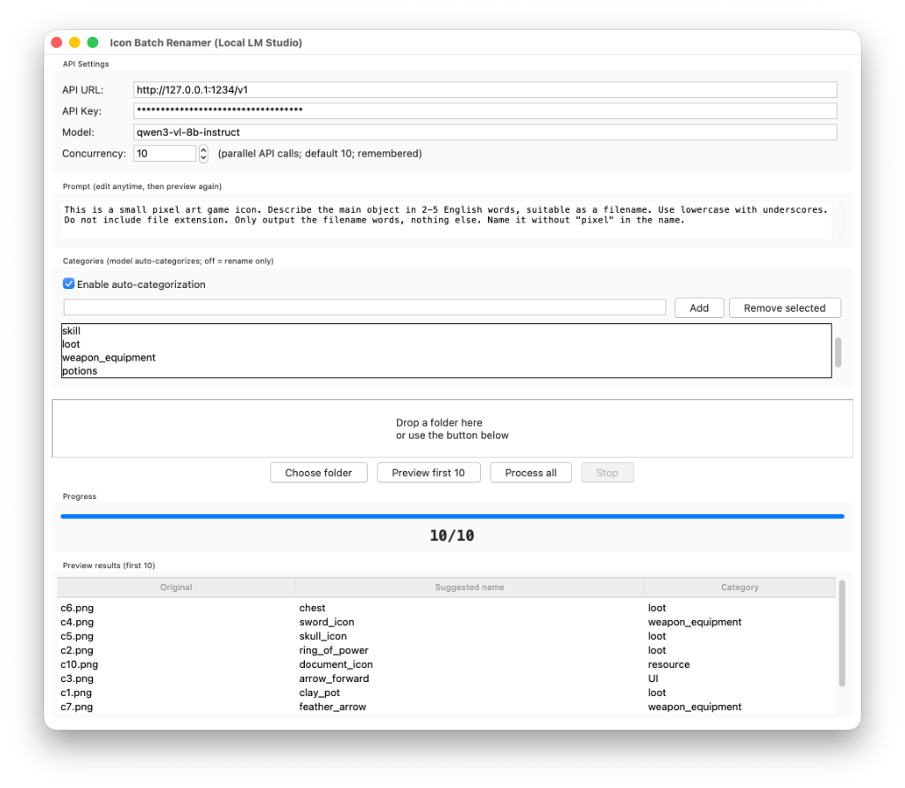

# Icon Batch Renamer

Desktop app that batch-renames (and optionally categorizes) game / pixel-art icons using a **local vision LLM** via [LM Studio](https://lmstudio.ai/) or any OpenAI-compatible API.



Original files are never modified. Results are copied into `renamed_output/` with a `rename_mapping.json` log.

## Features

- **Tkinter GUI** with folder drag-and-drop (or browse)
- **Vision LLM naming** — sends each image to a local OpenAI-compatible `/v1/chat/completions` endpoint
- **Editable prompt** — default prompt is tuned for small pixel-art game icons
- **Preview first 10** — check naming quality before running the full batch
- **Batch process all** — concurrent API calls with progress bar and **Stop**
- **Configurable concurrency** (並行數, 1–64) — remembered between sessions
- **Optional auto-categorization** — model picks a category; files go into subfolders
- **Safe filenames** — sanitized lowercase names with collision suffixes (`_1`, `_2`, …)
- **Persisted settings** — API URL / key / model / prompt / categories / concurrency saved locally (not committed to git)

## Requirements

### Runtime (app)

| Requirement | Notes |
|---|---|
| **macOS** | Primary target; launcher is a bash script for macOS |
| **Python 3.9+** | Prefer Homebrew Python (see below) |
| **Tk 8.6+** | System `/usr/bin/python3` often ships Tk 8.5, which breaks the UI on modern macOS |
| **`requests`** | HTTP client for the vision API |
| **`tkinterdnd2`** | Optional but recommended — enables folder drag-and-drop |

### Model server

| Requirement | Notes |
|---|---|
| **[LM Studio](https://lmstudio.ai/)** (or compatible) | Local OpenAI-compatible server on `http://127.0.0.1:1234/v1` by default |
| **Vision model** | Must accept image inputs |

**Recommended model:** `qwen3-vl-8b-instruct`

**Concurrency note:** If you want **並行數** (concurrent requests) to actually run in parallel, load the model as **GGUF** in LM Studio and enable parallel / multi-request serving there. Otherwise LM Studio will **queue** requests one-by-one even when this app sends many at once.

## Quick start (recommended)

1. Start LM Studio, load **`qwen3-vl-8b-instruct`** (GGUF if you want true parallelism), and start the local server.
2. In the project folder, run:

```bash
./run_icon_renamer.sh
```

The launcher will automatically:

- Find a Python with **Tk 8.6+** (prefers Homebrew)
- Try to install `python-tk` via Homebrew if needed
- Create / rebuild `.venv` when missing or broken
- Install Python deps (`requests`, `tkinterdnd2`)
- Launch the app

## Manual setup (optional)

Use this if you prefer to install everything yourself instead of relying on the `.sh` launcher.

### 1. Python + Tk (Homebrew)

```bash
brew install python@3.14 python-tk@3.14
```

(Any 3.9+ Homebrew Python + matching `python-tk@…` is fine.)

### 2. Virtual environment + packages

```bash
cd icon_renamer
python3 -m venv .venv
source .venv/bin/activate
pip install requests tkinterdnd2
python icon_renamer.py
```

### 3. LM Studio

1. Install [LM Studio](https://lmstudio.ai/)
2. Download / load **`qwen3-vl-8b-instruct`**
3. Prefer a **GGUF** build and configure LM Studio so concurrent requests are not serialized
4. Start the local server (default `http://127.0.0.1:1234`)
5. In the app, set:
   - **API URL:** `http://127.0.0.1:1234/v1`
   - **Model:** `qwen3-vl-8b-instruct` (or the exact loaded model id)

## Usage

1. Drop or select a folder of images (`.png`, `.jpg`, `.jpeg`, `.webp`, `.gif`, `.bmp`)
2. Adjust prompt / categories / concurrency if needed
3. Click **預覽前 10 張** to sanity-check names
4. Click **開始處理全部**
5. Find copies under `renamed_output/` (or `../<folder>_renamed_output` if the source folder is not writable)

Settings are saved to `icon_renamer_settings.json` next to the script (gitignored — may contain your API key).

## License

Use freely for your own asset pipelines. No warranty.
